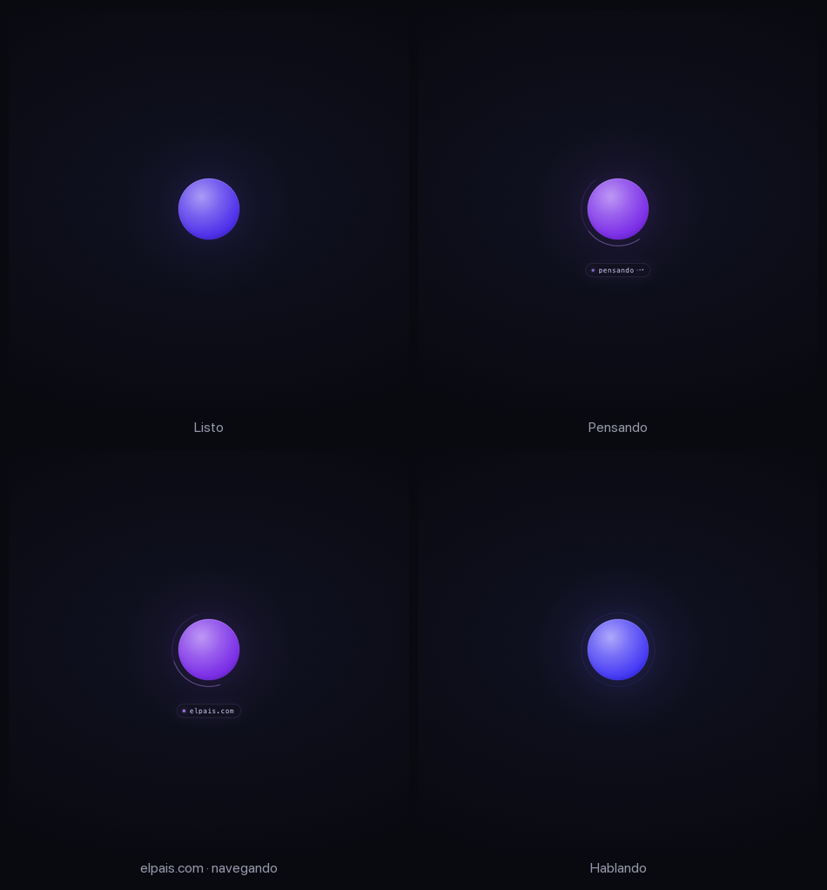
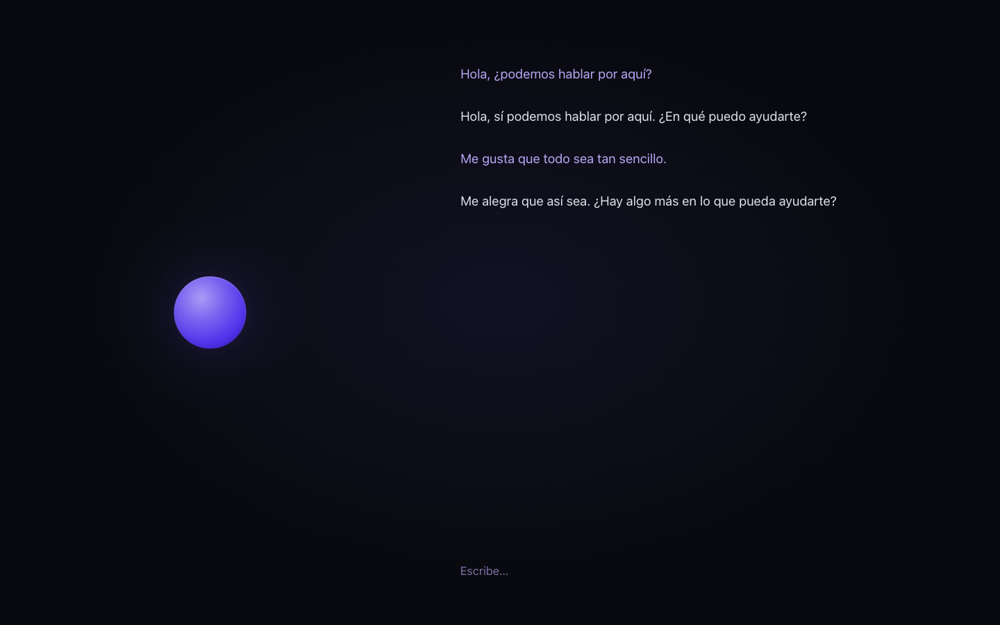

# dot

A Spanish-speaking local assistant whose entire UI is a single blue–purple dot.

The app starts [`llama.cpp`](https://github.com/ggml-org/llama.cpp) with
**NVIDIA‑Nemotron‑3.5‑Bolt‑E4B‑4GB** in the background, watches the model health
endpoint, and streams state into a minimal browser client. The dot pulses while the
model loads and stays steady once it is healthy. Arming it opens the microphone and
the conversation is hands-free: speak in Spanish, get an answer out loud. Optional
tools let it read public pages, check the weather, and shape the dot's expression
while it talks.


Each expression transitions to a distinct blue or violet shade; no state uses red.
Speech recognition defaults to Spanish (`es-ES`), with Kokoro's `ef_dora` voice.

See [PLAN.md](PLAN.md) for the design and [AGENTS.md](AGENTS.md) for contributor notes.

## Features

Local inference, Spanish voice by default, and almost nothing on screen:

- **Hands-free conversation** — streaming speech recognition and synthesis, semantic
  turn detection, interruption and backchannel handling. The mic stays open while armed.
- **Local reasoning** — enabled by default, never spoken; optional public-page and
  weather tools ground answers that need current information.
- **Breathing core** — halo, voice sphere and perimeter all animate on the same blue–violet
  palette (hues 207–278).
- **Dot states** — `starting` (pulsing), `ready` (steady), `loading_voice`, `listening`
  (attentive), `thinking`, `speaking` (playing), `error`.
- **Expressions** — `smile`, `sad`, `surprise`, `ask`, `angry`, `laugh`, each a distinct
  blue or violet shade.
- **One transient hint line**, one line below the dot:
  - while the model **thinks**, it reads `pensando` with three softly pulsing dots;
  - while a **browser tool opens a page**, it shows just the **hostname** of the target
    (for example `elpais.com`), no "navigating", no verbs, no status copy;
  - the hostname clears when navigation ends; `pensando` remains while waiting
    for the answer. Motion respects `prefers-reduced-motion`.

### In pictures



Full-size captures: [ready](docs/dot-ready.png) · [thinking](docs/dot-thinking.png) ·
[browsing](docs/dot-browsing.png) · [speaking](docs/dot-speaking.png).

### Type, too

Start typing anywhere, or focus **Escribe…**. The dot moves left and the conversation
appears on the right: violet for you, pale text for the assistant. No borders,
panels, bubbles or added background. On phones the dot sits above the conversation.

**Enter** sends · **Shift+Enter** adds a line · **Escape** with an empty draft returns
to the centered dot without clearing the conversation. Click the dot while a typed
reply is pending to cancel it. The input stays available for your next draft.

Typing uses `/api/chat` and needs no microphone permission. Switching from voice
closes the mic; accepted voice turns also appear in the transcript. The full visible
history lives only in the current page (reload clears it); model context is bounded.
Reasoning/tool internals never appear. Interrupted voice text is reconciled with
the server's sentence-level history estimate, not a word-exact playback record.



## Quick start

**Requirements:** Apple Silicon macOS (MLX voice), `uv`, Python 3.12, Node.js 18+
with npm (Playwright MCP), the Hugging
Face `hf` CLI for downloads, and a recent Metal-enabled `llama-server` supporting
Gemma 4 and `--jinja`. Build instructions are [below](#llamacpp). This project was
tested on an M5 with 24 GB unified memory; download sizes are not RAM requirements.

```bash
./run.sh
```

Open <http://127.0.0.1:8765>.

The first run creates a Python 3.12 virtualenv, installs the web + MLX dependencies,
and downloads the missing models. To fetch everything up front:

```bash
./run.sh --fetch
```

The fetch step downloads both GGUF files (6.18 GB target + 0.74 GB drafter), even
though speculative decoding is off by default. They live in `models/`; speech
models use the Hugging Face cache and load when voice is armed.

## What it runs

| Piece | Default | Size |
|---|---|---|
| LLM | [NVIDIA-Nemotron-3.5-Bolt-E4B-4GB](https://huggingface.co/nvidia/NVIDIA-Nemotron-3.5-Bolt-E4B-4GB), Q4_K_M | 6.18 GB |
| Drafter | [NVIDIA-Nemotron-3.5-Bolt-E4B-4GB-DFlash](https://huggingface.co/nvidia/NVIDIA-Nemotron-3.5-Bolt-E4B-4GB-DFlash), BF16 (opt-in) | 0.74 GB |
| VAD | `mlx-community/silero-vad` | ~2 MB |
| Turn detection | `mlx-community/smart-turn-v3` | ~0.1 GB |
| STT | `mlx-community/nemotron-3.5-asr-streaming-0.6b-8bit` | ~0.76 GB |
| TTS | `mlx-community/Kokoro-82M-8bit` | ~0.35 GB |

`llama-server` listens on `127.0.0.1:1234`; the app listens on `127.0.0.1:8765`.
The stock llama.cpp web UI is still reachable on 1234 while debugging.

### NVIDIA target + draft models

According to NVIDIA's linked model cards, Bolt is post-trained from Gemma-4-E4B-it,
with **8B total / 4B effective parameters**. The target card lists up to 64K tokens
for input/output; dot defaults to a **32,768-token context** and a 1,024-token
completion budget. Sampling follows the card: temperature **1.0**, top-p **0.95**.
Conversational mode keeps spoken answers concise.

The companion DFlash checkpoint is **360M parameters**, five Qwen3-style decoder
layers in a **736.81 MB BF16 GGUF**. It shares the target's embeddings and output
head and **cannot run standalone**. It proposes up to seven candidate tokens per
step for the target to verify. Both model cards specify
[OpenMDW-1.1](https://openmdw.ai/license/1-1/) governing terms and note the underlying
Gemma 4 Apache-2.0 terms; model licenses are separate from application code.

To enable the included drafter:

```bash
./run.sh --fetch
DFLASH=1 ./run.sh
```

If dot is attached to an already-running llama-server, restart that server with
draft support first; an environment flag cannot reconfigure an attached process.
DFlash remains opt-in because the [local Metal benchmark](#dflash-benchmark) did
not show a reliable speedup. NVIDIA's RTX 5090 acceptance measurements are not
Mac latency results.

### LAN access

Bind all interfaces and list the exact origin you will open, because
`/api/chat`, `/api/restart` and `/ws/voice` reject origins outside the allowlist:

```bash
DOT_HOST=0.0.0.0 \
DOT_TLS=1 \
DOT_ALLOWED_ORIGINS=https://192.168.1.20:8765 \
./run.sh
```

Plain HTTP can load the dot, but **not the microphone**: browsers expose
`getUserMedia` only on secure origins (`https://` or `localhost`). For voice on
another device, add `DOT_TLS=1`; `run.sh` creates a self-signed certificate in
`.tls/` (Git-ignored) valid for `localhost`, the machine's `*.local` name and its
current LAN addresses, and prints the `https://` URL. Accept the browser warning
once. If the machine's IP changes, `rm -rf .tls` and restart to reissue it.
`llama-server` keeps listening on loopback; only the web app is exposed.

## Dot states

| State | Meaning |
|---|---|
| `starting` | llama.cpp is loading; the dot pulses |
| `ready` | model is healthy; the dot is steady |
| `loading_voice` | speech models are loading |
| `listening` | microphone is open |
| `thinking` | waiting for the LLM (the `pensando` hint may show) |
| `speaking` | TTS is playing |
| `error` | failed; click to retry |

Click behaviour:

- ready (muted) → arm: open the mic and load the speech models
- listening → mute (the assistant keeps its last state; no turn is started)
- thinking / speaking → cancel the reply
- error → restart llama.cpp (or retry the voice socket)

The armed state is remembered in `localStorage`, so a reload goes straight back to
listening once the first gesture unlocks audio.

## Thinking

The model runs with reasoning enabled by default:

```json
"chat_template_kwargs": {
  "enable_thinking": true,
  "conversational_mode": true
}
```

`DOT_THINKING=0` turns it off. llama.cpp streams reasoning through
`reasoning_content`, separate from the spoken `content`: it is never sent to TTS,
history or the reply — it only drives the transient `pensando` hint and an
`assistant_reasoning` entry in the transcript.

The default completion budget is `DOT_MAX_TOKENS=1024` (reasoning plus answer).
Reasoning can still exhaust that shared budget. If a voice reply emits no content,
the turn uses a brief fallback line instead of silence; this is not a separate
reserved answer budget.

## Tools

The assistant can express emotion and operate an isolated browser:

| Tool | What it does |
|---|---|
| `browser_navigate(url)` | Opens a public page through Playwright MCP and returns an accessibility tree |
| `browse(url)` / `navigate(url)` | Compatibility aliases for `browser_navigate` |
| `browser_click(target)` | Clicks an exact ARIA ref from the current tree (not a selector) |
| `browser_type(target, text)` | Fills a field without submitting; returns the updated tree |
| `browser_navigate_back()` / `browser_hover(target)` / `browser_wait_for(...)` | Native MCP navigation, hover and bounded waiting |
| `browser_snapshot()` | Returns the current view again with fresh refs |
| `browser_close()` | Closes the browser; only on an explicit user request |
| `weather(place)` | Current weather and a three-day forecast from Open-Meteo |
| `current_time()` | Date/time from the local clock, explicitly in Europe/Madrid |
| `emotion` | Briefly changes the dot's expression: `smile`, `sad`, `surprise`, `ask`, `angry`, `laugh` |

Tools are on by default. `DOT_TOOLS=0` disables all tools; `DOT_BROWSE=0` disables
browser tools. `DOT_SEARCH=0` is still honored as a deprecated browser-disable switch
unless `DOT_BROWSE` is explicitly set. A turn allows six tool rounds by default.
Browser state persists across actions in a voice connection; HTTP tool loops get
their own session, closed at the end of the request.

Every browser action is a blocking tool: any answer the model invents after emitting
the call is discarded until the real result arrives. The model is told to keep the
browser open between questions, so follow-ups about a page it already read do not
reopen the URL.

This model writes tool calls as bare fragments instead of the `<|tool_call>` wrapper
llama.cpp expects, so `tools.InlineToolParser` recovers those fragments, executes
them, and keeps them out of the spoken reply. Positional, named and bare literal
arguments are supported. Browser actions block the rest of that model message until
their actual result arrives.

`weather(place)` does not browse: it queries Open-Meteo's keyless geocoding and
forecast endpoints directly, so “¿qué tiempo hace mañana?” works without a URL. The
model is told to use it instead of opening a search engine; those pages either
require JavaScript results, return antibot challenges, or both.

The former `web_search` was removed after live checks returned antibot pages and
throttling. The browser is a constrained public-page reader with interaction, not a
general browser sandbox: GET endpoints can still have server-side effects, and
captcha/empty-page/HTTP failures must not be treated as verified facts. See
[BROWSING.md](BROWSING.md).

## Browsing

`MCPBrowserSession` in `mcp_browser.py` connects to the official Playwright MCP
through a private stdio gateway (`mcp_browser.mjs`). Each conversation owns its
process and browser. This replaces the runtime's custom page-action implementation;
the older direct wrapper remains as a regression reference.

The gateway preserves dot's network and execution policy:

- native MCP discovery, navigation/actions and accessibility snapshots; only ARIA
  refs actually returned in the last view can be used, not arbitrary selectors;
- public HTTP(S) only, validated DNS pinned to a single public IP, same-host GET/HEAD
  only, no local addresses, no credentials, no downloads/uploads;
- snapshots bounded to about 8,000 characters (automatic snapshots use depth 12);
- a 20-second budget per action (excluding cleanup/error reporting);
- at most two concurrent browser sessions.

The browser is **strictly headless full Chromium**: no windows, minimization or
headed fallback. The UA comes from the installed browser, with only the
`HeadlessChrome` token normalized to `Chrome`; launch uses
`--disable-blink-features=AutomationControlled`. Locale/timezone/viewport remain `es-ES`, `Europe/Madrid`,
`1440×900`, with the sandbox and network policy intact. No stealth extensions,
personal profiles or hardcoded browser versions. The
[headless evaluation](docs/headless-evaluation.md) read El País's homepage with
this setup; it does not guarantee access or solve verification challenges.
Details in [BROWSING.md](BROWSING.md).

By default, eight approved browser tools are exposed. `DOT_MCP_ALL_TOOLS=1`
exposes the complete 72-tool native catalog, including blocked tools clearly marked
as disabled. **It never enables code execution, uploads, downloads, arbitrary
selectors, cookie/storage manipulation or private networking.** Both the Python
adapter and MCP gateway reject disallowed calls. See the
[live trial](docs/mcp-trial.md) for clock, Torremolinos weather and BTC checks.

llama.cpp also supports MCP itself, but configuring its web UI does not configure
dot. Keeping the MCP client in dot preserves per-conversation lifecycle and voice
cancellation; the existing LLM/tool loop remains responsible for orchestration.

## HTTP + WS

| Endpoint | Purpose |
|---|---|
| `GET /events` | SSE snapshots of the llama state |
| `GET /health` | JSON state for scripts |
| `POST /api/chat` | non-streaming chat proxy; runs tools and returns a `dot_tools` trace |
| `POST /api/restart` | restart (or re-attach) llama-server |
| `WS /ws/voice` | binary 16 kHz PCM up, JSON events + 24 kHz PCM down |

A quick chat check:

```bash
curl -s localhost:8765/api/chat \
  -H 'content-type: application/json' \
  -d '{"prompt":"Saluda en cinco palabras."}' | jq -r '.choices[0].message.content'
```

For multi-turn HTTP chat, send a `messages` array instead of `prompt`; the caller
supplies history. The response follows llama.cpp's chat-completion shape with an
additional `dot_tools` trace. This endpoint does not stream audio.

Voice clients send `arm`/`disarm`/`cancel` controls and 20 ms mono int16 PCM frames.
Playback uses `interrupt {turn_id, played_ms}` and `playback_done {turn_id}` to track
the audible tail. Server JSON carries states, transcripts, reply deltas, TTS
boundaries, barge-in, reasoning, browsing and emotion events; binary messages carry
24 kHz mono int16 audio. See [AGENTS.md](AGENTS.md#voice-protocol) for the full protocol.

## Configuration

| Variable | Default | Meaning |
|---|---|---|
| `DOT_HOST` / `DOT_PORT` | `127.0.0.1` / `8765` | web app bind (`0.0.0.0` for LAN) |
| `DOT_ALLOWED_ORIGINS` | local hosts | comma-separated origins allowed to use chat/WS |
| `DOT_TLS` | off | `1` serves HTTPS with a generated self-signed certificate |
| `LLAMA_HOST` / `LLAMA_PORT` | `127.0.0.1` / `1234` | llama.cpp bind |
| `LLAMA_BIN` | `~/Projects/llama.cpp/build/bin/llama-server` | binary |
| `MODEL` | `models/Nemotron-3.5-Bolt-E4B-Q4_K_M.gguf` | target weights |
| `DRAFTER` | `models/Nemotron-3.5-Bolt-E4B-DFlash-BF16.gguf` | draft weights; used only with `DFLASH=1` |
| `CTX` | `32768` | context size |
| `NGL` | `99` | GPU layers |
| `KEEP_LLAMA=1` | off | leave llama.cpp running after exit |
| `LLAMA_NO_SPAWN=1` | off | attach only |
| `DFLASH=1` | off | enable DFlash speculative decoding |
| `TTS_VOICE` | `ef_dora` | Kokoro voice (Spanish by default) |
| `TTS_LANG` | `e` | Kokoro language code (`e` = Spanish) |
| `ASR_LANGUAGE` | `es-ES` | Nemotron locale (`auto` for multilingual recognition) |
| `ASR_DELAY_MS` | `160` | 80 / 160 / 560 / 1120 ms look-ahead |
| `VAD_THRESHOLD` | `0.5` | speech probability threshold |
| `MAX_TURN_S` | `30` | hard cap on one utterance |
| `VAD_SILENCE_MS` | `300` | pause that makes a turn-end candidate |
| `PREROLL_MS` | `500` | audio kept from before onset |
| `MIN_TURN_MS` | `250` | ignore shorter bursts |
| `TURN_MAX_WAIT_MS` | `2000` | commit an unfinished thought after this |
| `SEMANTIC_TURN` | `1` | Smart Turn v3 endpointing |
| `TURN_THRESHOLD` | `0.6` | Smart Turn "complete" threshold |
| `BARGE_HOLD_MS` | `1200` | sustained speech that counts as a floor bid |
| `BACKCHANNEL_MAX_MS` | `900` | short bursts treated as listener signals |
| `DOT_TOOLS` | `1` | automatic emotion and browser tools |
| `DOT_BROWSE` | `1` | all browser tools |
| `DOT_BROWSE_TIMEOUT` | `20` | seconds allowed per browser action (plus cleanup) |
| `DOT_WEATHER_TIMEOUT` | `8` | seconds allowed for the weather lookup |
| `DOT_TOOL_ROUNDS` | `6` | tool rounds allowed per turn |
| `DOT_MAX_TOKENS` | `1024` | completion tokens for reasoning + answer |
| `DOT_THINKING` | `1` | reasoning on (`enable_thinking`); never spoken |
| `DOT_MCP_ALL_TOOLS` | off | full MCP schema experiment; execution policy is unchanged |
| `VOICE_WARMUP` | `1` | warm Kokoro at load; set `0` to skip |
| `VOICE_DEBUG` | off | log turn, barge and truncation decisions |

## llama.cpp

Built from `~/Projects/llama.cpp` with Metal. If it needs a rebuild:

```bash
cmake -S . -B build -G Ninja -DCMAKE_BUILD_TYPE=Release \
  -DCMAKE_OSX_ARCHITECTURES=arm64 -DGGML_NATIVE=ON -DGGML_METAL=ON \
  -DGGML_ACCELERATE=ON -DGGML_LTO=ON -DGGML_CCACHE=ON \
  -DLLAMA_BUILD_SERVER=ON -DLLAMA_BUILD_TESTS=OFF \
  -DLLAMA_BUILD_EXAMPLES=OFF -DLLAMA_OPENSSL=OFF
cmake --build build --target llama-server llama-bench -j10
```

`-DLLAMA_OPENSSL=OFF` avoids a CMake generation failure on this Mac (Homebrew
OpenSSL exposes no `OpenSSL::SSL` target). HTTPS is not needed on localhost.

## Voice turns

Click once to arm: the first click asks for microphone access, loads the speech
models (~5 s with a warm cache, longer on first download), and keeps the mic open
from then on. Speak; Silero detects onset and a 300 ms pause starts endpointing.
Smart Turn v3 then decides whether that pause was the end of your thought or just a
breath. After a commit the dot goes `thinking` → `speaking` and the reply streams
sentence by sentence.

Talk over the reply to interrupt. Playback pauses as soon as speech is detected; the
server confirms the barge from the transcript or after 1.2 s of sustained speech,
cancels generation, truncates the assistant message to what you actually heard, and
treats your sentence as the next turn. A backchannel such as “mm-hmm” — or a cough —
is discarded and the reply resumes where it stopped. Imperatives such as “stop”,
“wait”/“espera”, “para” and “no” always take the floor. Click while thinking or
speaking to cancel.

Warm latency on this M5: the dot leaves `listening` about 0.3–0.4 s after you stop
(300 ms pause + Smart Turn inference), and the first spoken sentence usually starts
about 0.7 s after that. Streaming transcripts trail the audio by ~0.7 s (the ASR
model's look-ahead), which is why barge confirmation also uses speech duration
rather than waiting for text.

While waiting for an answer, the hint shows `pensando`; a navigation hostname takes
priority while that action runs. Neither reasoning nor tool syntax is spoken.

## DFlash benchmark

The drafter is downloaded but off by default. This llama.cpp build's `llama-bench`
has no draft flags, so the numbers below come from `/v1/chat/completions`
`timings.predicted_per_second` (128 generated tokens, temperature 0):

| Config | Median decode | Delta |
|---|---|---|
| base | 31.0–31.3 tok/s | — |
| DFlash, n-max 4 | 28.9–36.0 tok/s | −6.9% … +14.9% |
| DFlash, n-max 7 | 34.2–34.3 tok/s | +9.5% |
| DFlash, n-max 10 | 33.8 tok/s | +7.9% |
| DFlash, n-max 16 | 33.6 tok/s | +7.4% |

The spread is noise-dominated and the greedy output changed, so the drafter stays
opt-in. To try it:

```bash
DFLASH=1 ./run.sh
```

`llama_manager.py` passes `--spec-type draft-dflash --spec-draft-n-max 7` when the
drafter is enabled. A repeatable benchmark should stop the dot app first and use
the same prompt across runs.

## Privacy and transcripts

Inference and audio processing run locally. Initial setup downloads models and
Chromium; enabled browser/weather tools make network requests. Browsing sends the
requested URL and interactions to that site; weather sends the place name to
Open-Meteo. Set `DOT_TOOLS=0` for conversation without these network tools.

Voice and HTTP conversations append to **`.chat`**, a private, unencrypted,
owner-only JSONL file ignored by Git. It includes accepted messages, ASR diagnostics,
reasoning, tool calls/results, generated/synthesized replies, playback reports,
controls and errors, even with `VOICE_DEBUG=0`. HTTP history supplied by a caller
is logged again for that request. No raw audio is stored, and the transcript file
is not exposed by an HTTP endpoint. Model context and tool arguments can still
include conversation-derived text.

Playwright MCP can also write snapshot artifacts under Git-ignored
`.playwright-mcp/`. These contain page text and may include queries typed into
pages; treat them as private and remove/archive them while the app is stopped.

Generated text and synthesized audio do **not** prove playback. Interrupted text is
only a sentence-level estimate; cancellation may have no playback position. Writes
use a dedicated background thread and drain on clean shutdown. There is no retention
limit: archive/remove `.chat` while the app is stopped. Inspect it locally with
`tail -f .chat`; never commit it or publish it with diagnostics.

The browser uses a fresh profile, not your personal cookies. Keep the app on
loopback unless needed: origin checks are not authentication, and TLS does not make
this a safe public service.

## Limitations

- Apple Silicon/MLX is the supported voice path; Linux/CUDA and Windows are not
  validated end to end. First downloads and voice warmup take time.
- The model can hallucinate, misread a page or exhaust its reasoning budget.
  Current facts need successful tool evidence; blocked pages are not evidence.
- Browsing is a restricted public-page reader, not account automation or a reliable
  search engine. Captchas, paywalls, third-party assets and POST APIs may block it.
  JavaScript remains enabled; disabling it did not fix the observed DataDome 403.
- Echo cancellation affects interruption accuracy. Headphones help; ASR latency,
  ambient noise and backchannels can still cause missed or unwanted turns.
- DFlash gains are hardware/workload dependent, and the shared context is finite.
  The assistant is not intended for safety-critical decisions.

## Troubleshooting

- **Dot stays muted purple / `/health` says error** — check `logs/llama.log`; the JSON
  error includes the last log lines on crashes.
- **Port 1234 busy** — stop the other server or set `LLAMA_PORT`.
- **Voice says "voice unavailable"** — the MLX models are still downloading, or
  the venv was built with Python ≥3.13 (`misaki` needs <3.13).
- **No mic** — the browser only exposes `getUserMedia` on `localhost` or HTTPS.
- **Browser says a page requires verification** — even the configured headless
  profile may encounter 403/captchas. Report the block or try another public source;
  no visible-browser fallback or challenge solving is enabled. See [BROWSING.md](BROWSING.md).

## Tests

```bash
.venv/bin/python -m unittest discover -s tests -p 'test_*.py' -v
node --check static/app.js
node --check mcp_browser.mjs
bash -n run.sh
```

Browser tests exercise real Chromium against intercepted fixture pages (no network
required). Live engine conversations are opt-in:

```bash
DOT_TEST_CORE=1 .venv/bin/python -m unittest discover -s tests -p 'test_core_conversations.py' -v
```

The three full-catalog checks (local time, Torremolinos tomorrow, BTC/USD) use the
real model and public network and are separately opt-in:

```bash
DOT_TEST_MCP_LIVE=1 .venv/bin/python -m unittest discover -s tests -p 'test_mcp_live_tasks.py' -v
```
