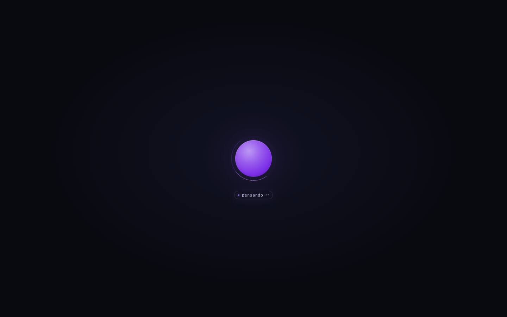
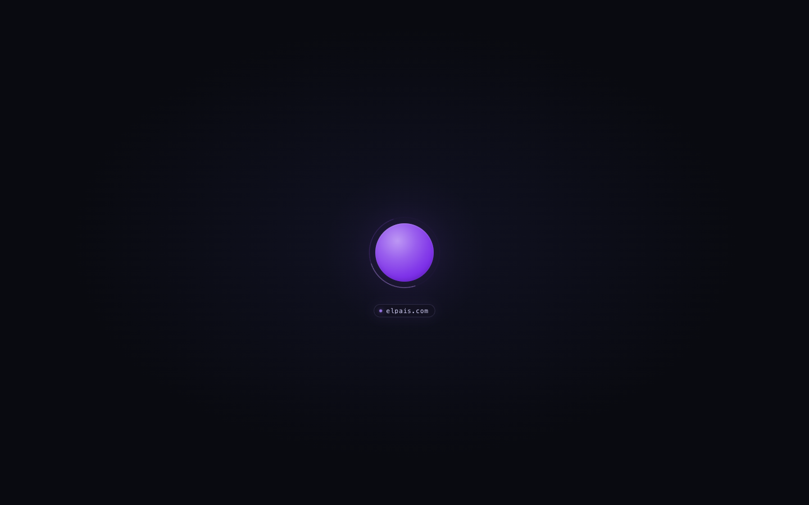

# dot

A Spanish-speaking local assistant whose entire UI is a single blue–purple dot.

The app starts [`llama.cpp`](https://github.com/ggml-org/llama.cpp) with
**NVIDIA‑Nemotron‑3.5‑Bolt‑E4B‑4GB** in the background, watches the model health
endpoint, and streams state into a minimal browser client. The dot pulses while the
model loads and stays steady once it is healthy. Arming it opens the microphone and
the conversation is hands-free: speak in Spanish, get an answer out loud. Optional
tools let it read public pages, check the weather, and shape the dot's expression
while it talks.


Each expression transitions to a distinct blue or violet shade; no state uses red.
Speech recognition defaults to Spanish (`es-ES`), with Kokoro's `ef_dora` voice.

See [PLAN.md](PLAN.md) for the design and [AGENTS.md](AGENTS.md) for contributor notes.

## The dot

There is no text, no chrome, no background clutter. The whole interface is the dot:

- **Breathing core** — halo, voice sphere and perimeter all animate on the same blue–violet
  palette (hues 207–278).
- **Dot states** — `starting` (pulsing), `ready` (steady), `loading_voice`, `listening`
  (attentive), `thinking`, `speaking` (playing), `error`.
- **Expressions** — `smile`, `sad`, `surprise`, `ask`, `angry`, `laugh`, each a distinct
  blue or violet shade.
- **One transient hint line**, one line below the dot:
  - while the model **thinks**, it reads `pensando` with three softly pulsing dots;
  - while a **browser tool opens a page**, it shows just the **hostname** of the target
    (for example `elpais.com`), no "navigating", no verbs, no status copy;
  - it hides itself when the answer starts or the browser action ends, and every
    animation respects `prefers-reduced-motion`.






## Conversation transcripts

All new voice and `/api/chat` conversations append to **`.chat`** in this directory. It is
a UTF-8 JSONL file (one timestamped event per line), grouped by `session` and, for voice,
`turn`. It survives restarts and is ignored by Git.

```bash
tail -f .chat
```

`message` holds accepted user turns and HTTP messages. Voice diagnostics include
`asr_partial`, `asr_final`, `asr_pause`, `assistant_generated` (full generated reply),
`assistant_audio` (synthesized sentences, not proof they were heard),
`assistant_history` (the internal conversation history), and `assistant_playback`
(client-reported completion or interruption). Interrupted playback text is only a
**sentence-level estimate**, not a word-exact transcript of what was heard.
Controls, barge/backchannel decisions, errors and session boundaries are recorded
too, even with `VOICE_DEBUG=0`. Manual cancellation/disconnect may have no playback
position; the log does not invent one. HTTP requests that include prior messages
record that context again under the new request's session ID.

The file contains **private, unencrypted conversation text**, with owner-only file
permissions. No raw audio is stored and no transcript is sent elsewhere or served by
an HTTP endpoint. Disk writes run on a dedicated background thread, outside both audio
executors, and drain on clean shutdown. Disk errors are reported in the app logs
without stopping a conversation. There is no automatic retention limit; archive/remove
the file while the app is stopped if needed.

## Quick start

```bash
./run.sh
```

Open <http://127.0.0.1:8765>.

The first run creates a Python 3.12 virtualenv, installs the web + MLX dependencies,
and downloads the missing models. To fetch everything up front:

```bash
./run.sh --fetch
```

The GGUF weights (6.18 GB + optional drafter) live in `models/`. The speech models
(~1.1 GB) go to the Hugging Face cache and load on the first voice turn.

## What it runs

| Piece | Default | Size |
|---|---|---|
| LLM | `nvidia/NVIDIA-Nemotron-3.5-Bolt-E4B-4GB` Q4_K_M | 6.18 GB |
| Drafter | `Nemotron-3.5-Bolt-E4B-DFlash-BF16.gguf` (opt‑in) | 0.74 GB |
| VAD | `mlx-community/silero-vad` | ~2 MB |
| STT | `mlx-community/nemotron-3.5-asr-streaming-0.6b-8bit` | ~0.76 GB |
| TTS | `mlx-community/Kokoro-82M-8bit` | ~0.35 GB |

`llama-server` listens on `127.0.0.1:1234`; the app listens on `127.0.0.1:8765`.
The stock llama.cpp web UI is still reachable on 1234 while debugging.

### LAN access

Bind all interfaces and list the exact origin you will open, because
`/api/chat`, `/api/restart` and `/ws/voice` reject origins outside the allowlist:

```bash
DOT_HOST=0.0.0.0 \
DOT_ALLOWED_ORIGINS=http://192.168.1.20:8765 \
./run.sh
```

The dot loads over plain HTTP, but **the microphone does not**: browsers expose
`getUserMedia` only on secure origins (`https://` or `localhost`). For voice on
another device, add `DOT_TLS=1`; `run.sh` creates a self-signed certificate in
`.tls/` (Git-ignored) valid for `localhost`, the machine's `*.local` name and its
current LAN addresses, and prints the `https://` URL. Accept the browser warning
once. If the machine's IP changes, `rm -rf .tls` and restart to reissue it.
`llama-server` keeps listening on loopback; only the web app is exposed.

## Dot states

| State | Meaning |
|---|---|
| `starting` | llama.cpp is loading; the dot pulses |
| `ready` | model is healthy; the dot is steady |
| `loading_voice` | speech models are loading |
| `listening` | microphone is open |
| `thinking` | waiting for the LLM (the `pensando` hint may show) |
| `speaking` | TTS is playing |
| `error` | failed; click to retry |

Click behaviour:

- ready (muted) → arm: open the mic and load the speech models
- listening → mute (the assistant keeps its last state; no turn is started)
- thinking / speaking → cancel the reply
- error → restart llama.cpp (or retry the voice socket)

The armed state is remembered in `localStorage`, so a reload goes straight back to
listening once the first gesture unlocks audio.

## Thinking

The model runs with reasoning enabled by default:

```json
"chat_template_kwargs": {
  "enable_thinking": true,
  "conversational_mode": true
}
```

`DOT_THINKING=0` turns it off. llama.cpp streams reasoning through
`reasoning_content`, separate from the spoken `content`: it is never sent to TTS,
history or the reply — it only drives the transient `pensando` hint and an
`assistant_reasoning` entry in the transcript.

The default completion budget is `DOT_MAX_TOKENS=1024` (reasoning plus answer), so a
long reasoning chain cannot consume the whole budget and leave the turn silent. If
the model never emits content, the turn ends with a calm fallback line instead of
silence.

## Tools

The assistant can express emotion and operate an isolated browser:

| Tool | What it does |
|---|---|
| `browse(url)` / `navigate(url)` | Opens a public page and returns an accessibility tree with ARIA refs |
| `browser_click(ref)` | Clicks an element by its exact reference from the current accessibility tree |
| `browser_type(ref, text)` | Fills a field without submitting; returns the updated accessibility tree |
| `browser_snapshot()` | Returns the current view again with fresh refs |
| `browser_close()` | Closes the browser; only on an explicit user request |
| `weather(place)` | Current weather and a three-day forecast from Open-Meteo |
| `emotion` | Briefly changes the dot's expression: `smile`, `sad`, `surprise`, `ask`, `angry`, `laugh` |

Tools are on by default. `DOT_TOOLS=0` disables all tools; `DOT_BROWSE=0` leaves only
`emotion`. `DOT_SEARCH=0` is still honored as a deprecated browser-disable switch
unless `DOT_BROWSE` is explicitly set. A turn allows six tool rounds by default.
Browser state persists across actions in a voice connection; HTTP tool loops get
their own session, closed at the end of the request.

Every browser action is a blocking tool: any answer the model invents after emitting
the call is discarded until the real result arrives. The model is told to keep the
browser open between questions, so follow-ups about a page it already read do not
reopen the URL.

This model writes tool calls as bare fragments instead of the `<|tool_call>` wrapper
llama.cpp expects, so `tools.InlineToolParser` recovers those fragments, executes
them, and keeps them out of the spoken reply. Positional, named and bare literal
arguments are supported. Browser actions block the rest of that model message until
their actual result arrives.

`weather(place)` does not browse: it queries Open-Meteo's keyless geocoding and
forecast endpoints directly, so “¿qué tiempo hace mañana?” works without a URL. The
model is told to use it instead of opening a search engine; those pages either
require JavaScript results, return antibot challenges, or both.

The former `web_search` was removed after live checks returned antibot pages and
throttling. The browser is a constrained public-page reader with interaction, not a
general browser sandbox: GET endpoints can still have server-side effects, and
captcha/empty-page/HTTP failures must not be treated as verified facts. See
[BROWSING.md](BROWSING.md).

## Browsing

`BrowserSession` in `browser_tool.py` wraps an isolated browser per conversation with:

- Playwright's `aria_snapshot(mode="ai")` and `get_by_ref()`, like Playwright MCP — not a
  hand-built CSS inventory;
- public HTTP(S) only, validated DNS pinned to a single public IP, same-host GET/HEAD
  only, no local addresses, no credentials, no downloads/uploads;
- a snapshot bounded to 8,000 characters at accessibility depth 12;
- a 20-second budget per action (excluding cleanup/error reporting);
- at most two concurrent browser sessions.

The browser is **headed Chromium with its window minimized** (via CDP). Some sites,
including `elpais.com` (DataDome), answer 403 to every headless Chromium variant; a
headed browser receives the normal page. Without a GUI session the tool falls back to
headless. The window is minimized immediately, so it never appears on screen. Details
in [BROWSING.md](BROWSING.md).

## HTTP + WS

| Endpoint | Purpose |
|---|---|
| `GET /events` | SSE snapshots of the llama state |
| `GET /health` | JSON state for scripts |
| `POST /api/chat` | non-streaming chat proxy; runs tools and returns a `dot_tools` trace |
| `POST /api/restart` | restart (or re-attach) llama-server |
| `WS /ws/voice` | binary 16 kHz PCM up, JSON events + 24 kHz PCM down |

A quick chat check:

```bash
curl -s localhost:8765/api/chat \
  -H 'content-type: application/json' \
  -d '{"prompt":"Saluda en cinco palabras."}' | jq -r '.choices[0].message.content'
```

## Configuration

| Variable | Default | Meaning |
|---|---|---|
| `DOT_HOST` / `DOT_PORT` | `127.0.0.1` / `8765` | web app bind (`0.0.0.0` for LAN) |
| `DOT_ALLOWED_ORIGINS` | local hosts | comma-separated origins allowed to use chat/WS |
| `DOT_TLS` | off | `1` serves HTTPS with a generated self-signed certificate |
| `LLAMA_HOST` / `LLAMA_PORT` | `127.0.0.1` / `1234` | llama.cpp bind |
| `LLAMA_BIN` | `~/Projects/llama.cpp/build/bin/llama-server` | binary |
| `MODEL` | `models/Nemotron-3.5-Bolt-E4B-4GB.gguf` | weights |
| `CTX` | `32768` | context size |
| `NGL` | `99` | GPU layers |
| `KEEP_LLAMA=1` | off | leave llama.cpp running after exit |
| `LLAMA_NO_SPAWN=1` | off | attach only |
| `DFLASH=1` | off | enable DFlash speculative decoding |
| `TTS_VOICE` | `ef_dora` | Kokoro voice (Spanish by default) |
| `TTS_LANG` | `e` | Kokoro language code (`e` = Spanish) |
| `ASR_LANGUAGE` | `es-ES` | Nemotron locale (`auto` for multilingual recognition) |
| `ASR_DELAY_MS` | `160` | 80 / 160 / 560 / 1120 ms look-ahead |
| `VAD_THRESHOLD` | `0.5` | speech probability threshold |
| `MAX_TURN_S` | `30` | hard cap on one utterance |
| `VAD_SILENCE_MS` | `300` | pause that makes a turn-end candidate |
| `PREROLL_MS` | `500` | audio kept from before onset |
| `MIN_TURN_MS` | `250` | ignore shorter bursts |
| `TURN_MAX_WAIT_MS` | `2000` | commit an unfinished thought after this |
| `SEMANTIC_TURN` | `1` | Smart Turn v3 endpointing |
| `TURN_THRESHOLD` | `0.6` | Smart Turn "complete" threshold |
| `BARGE_HOLD_MS` | `1200` | sustained speech that counts as a floor bid |
| `BACKCHANNEL_MAX_MS` | `900` | short bursts treated as listener signals |
| `DOT_TOOLS` | `1` | automatic emotion and browser tools |
| `DOT_BROWSE` | `1` | all browser tools |
| `DOT_BROWSE_TIMEOUT` | `20` | seconds allowed per browser action (plus cleanup) |
| `DOT_WEATHER_TIMEOUT` | `8` | seconds allowed for the weather lookup |
| `DOT_TOOL_ROUNDS` | `6` | tool rounds allowed per turn |
| `DOT_MAX_TOKENS` | `1024` | completion tokens for reasoning + answer |
| `DOT_THINKING` | `1` | reasoning on (`enable_thinking`); never spoken |
| `VOICE_WARMUP` | `1` | warm Kokoro at load; set `0` to skip |
| `VOICE_DEBUG` | off | log turn, barge and truncation decisions |

## llama.cpp

Built from `~/Projects/llama.cpp` with Metal. If it needs a rebuild:

```bash
cmake -S . -B build -G Ninja -DCMAKE_BUILD_TYPE=Release \
  -DCMAKE_OSX_ARCHITECTURES=arm64 -DGGML_NATIVE=ON -DGGML_METAL=ON \
  -DGGML_ACCELERATE=ON -DGGML_LTO=ON -DGGML_CCACHE=ON \
  -DLLAMA_BUILD_SERVER=ON -DLLAMA_BUILD_TESTS=OFF \
  -DLLAMA_BUILD_EXAMPLES=OFF -DLLAMA_OPENSSL=OFF
cmake --build build --target llama-server llama-bench -j10
```

`-DLLAMA_OPENSSL=OFF` avoids a CMake generation failure on this Mac (Homebrew
OpenSSL exposes no `OpenSSL::SSL` target). HTTPS is not needed on localhost.

## Voice turns

Click once to arm: the first click asks for microphone access, loads the speech
models (~5 s with a warm cache, longer on first download), and keeps the mic open
from then on. Speak; Silero detects onset and a 300 ms pause starts endpointing.
Smart Turn v3 then decides whether that pause was the end of your thought or just a
breath. After a commit the dot goes `thinking` → `speaking` and the reply streams
sentence by sentence.

Talk over the reply to interrupt. Playback pauses as soon as speech is detected; the
server confirms the barge from the transcript or after 1.2 s of sustained speech,
cancels generation, truncates the assistant message to what you actually heard, and
treats your sentence as the next turn. A backchannel such as “mm-hmm” — or a cough —
is discarded and the reply resumes where it stopped. Imperatives such as “stop”,
“wait”/“espera”, “para” and “no” always take the floor. Click while thinking or
speaking to cancel.

Warm latency on this M5: the dot leaves `listening` about 0.3–0.4 s after you stop
(300 ms pause + Smart Turn inference), and the first spoken sentence usually starts
about 0.7 s after that. Streaming transcripts trail the audio by ~0.7 s (the ASR
model's look-ahead), which is why barge confirmation also uses speech duration
rather than waiting for text.

While it thinks, the hint line shows `pensando`; while it answers it is replaced by
whatever the browser hint needs, and it never says the assistant's reasoning aloud.

## DFlash benchmark

The drafter is downloaded but off by default. This llama.cpp build's `llama-bench`
has no draft flags, so the numbers below come from `/v1/chat/completions`
`timings.predicted_per_second` (128 generated tokens, temperature 0):

| Config | Median decode | Delta |
|---|---|---|
| base | 31.0–31.3 tok/s | — |
| DFlash, n-max 4 | 28.9–36.0 tok/s | −6.9% … +14.9% |
| DFlash, n-max 7 | 34.2–34.3 tok/s | +9.5% |
| DFlash, n-max 10 | 33.8 tok/s | +7.9% |
| DFlash, n-max 16 | 33.6 tok/s | +7.4% |

The spread is noise-dominated and the greedy output changed, so the drafter stays
opt-in. To try it:

```bash
DFLASH=1 ./run.sh
```

`llama_manager.py` passes `--spec-type draft-dflash --spec-draft-n-max 7` when the
drafter is enabled. A repeatable benchmark should stop the dot app first and use
the same prompt across runs.

## Troubleshooting

- **Dot stays muted purple / `/health` says error** — check `logs/llama.log`; the JSON
  error includes the last log lines on crashes.
- **Port 1234 busy** — stop the other server or set `LLAMA_PORT`.
- **Voice says "voice unavailable"** — the MLX models are still downloading, or
  the venv was built with Python ≥3.13 (`misaki` needs <3.13).
- **No mic** — the browser only exposes `getUserMedia` on `localhost` or HTTPS.
- **Browser says a page requires verification** — some sites (DataDome-backed, such as
  `elpais.com`) answer 403 to headless Chromium; the browser runs headed with a
  minimized window instead. See [BROWSING.md](BROWSING.md).

## Tests

```bash
.venv/bin/python -m unittest discover -s tests -p 'test_*.py' -v
```

Browser tests exercise real Chromium against intercepted fixture pages (no network
required). Live engine conversations are opt-in:

```bash
DOT_TEST_CORE=1 .venv/bin/python -m unittest discover -s tests -p 'test_core_conversations.py' -v
```
